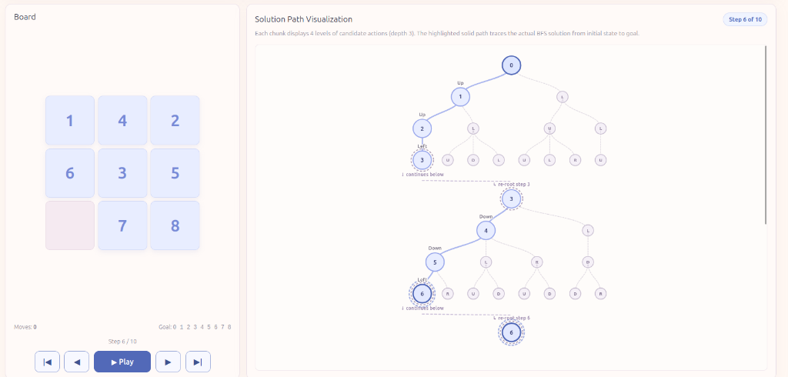
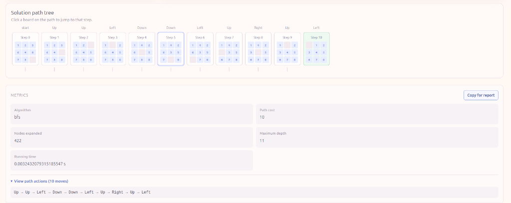
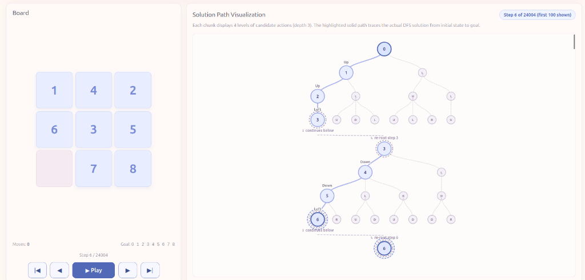

# 🧩 8-Puzzle Graph Solver & Interactive Visualizer

An end-to-end, high-performance artificial intelligence application for solving and visualizing the classic **8-Puzzle** problem. Built with a **Python (FastAPI)** graph search backend and an interactive **Angular (TypeScript + SVG)** vector frontend.

---

## 🖥️ Interactive GUI & Tree Visualizer Showcase

The application features a responsive web interface built with **Angular (TypeScript)** and native **HTML5 SVG**, providing real-time vector visualization with zero third-party chart dependencies.

### 1. Solution Tree Visualization (Backbone + Lookahead Branches)


* **Solution Backbone (Solid Path):** The primary path rendered in solid blue directly follows the winning step-by-step solution from the initial board down to the goal.
* **Alternative Candidate Branches (Dashed Leaves):** At each step, the tree generates all valid orthogonal blank moves (`Up`, `Down`, `Left`, `Right`) using `getSuccessors()`. Rejected branches appear as light purple leaves labeled with their move initial (`U`, `D`, `L`, `R`), clearly showing the alternative choices considered.
* **Cycle Pruning (`reverseAction`):** Immediate reversals (e.g. `Right` followed immediately by `Left`) are pruned automatically to keep the tree clean and avoid cycle clutter.
* **Long Path Chunking:** Long paths (such as 10 or 27 moves) are partitioned into readable **3-step chunks**. A wavy, dashed S-curve continuation connector links Chunk $N$ (`continues below`) to the root of Chunk $N+1$ (`re-root step X`), eliminating endless vertical scrolling.
* **Cubic Bézier Edges:** All tree connectors are smooth cubic Bézier curves (`M... C...`) measured and animated dynamically.

---

### 2. Live Metrics Card & Solution Path Ribbon


* **Horizontal Path Ribbon:** Displays mini $3 \times 3$ thumbnail boards for each consecutive step (Step 0 to Goal), with intermediate move direction labels. Clicking any thumbnail immediately jumps the board to that step.
* **Live Benchmark Metrics:** Displays real-time performance telemetry: **Algorithm**, **Path Cost**, **Nodes Expanded**, **Maximum Depth**, and **Running Time (seconds)**.
* **Action Sequence Viewer:** A collapsible `<details>` section showing the raw move chain (`Up → Up → Left → ...`).
* **1-Click Report Export ("Copy for report"):** Formats the benchmark metrics and action sequence into clean Markdown/text and copies it directly to your clipboard.

---

### 3. Deep Search Safeguards (DFS Visualization)


* **Truncation Safeguard:** When running algorithms that generate tens of thousands of steps (like DFS returning 24,004 moves), the visualizer renders the first 100 steps safely (`first 100 shown`), preventing browser tab crashes while preserving full playback telemetry.

---

### 4. Interactive GUI Controls Guide
* **Input Board Bar:** Enter any custom 9-digit space-separated sequence, click **Shuffle** to generate a guaranteed-solvable permutation, or click **Reset**.
* **Algorithm Selector:** Dropdown to select **BFS**, **DFS**, **Iterative DFS**, or **A\*** (with **Manhattan** or **Euclidean** distance radio selectors).
* **Playback Controls:**
  * `|◄` Jump to initial state (Step 0)
  * `◄` Step backward by 1 move
  * `► Play` / `❚❚ Pause` Auto-play step-by-step tile animation
  * `►` Step forward by 1 move
  * `►|` Jump to goal state
* **Two-Way Synchronization:** Clicking any node in the SVG tree or any thumbnail in the path ribbon instantly synchronizes the main $3 \times 3$ interactive puzzle board. During playback, the tree smoothly auto-scrolls to keep the active node centered.

---

## 🎯 Overview & Problem Formulation

The **8-Puzzle** is a classical state-space search problem consisting of a $3 \times 3$ grid containing eight numbered square tiles (labeled $1$ through $8$) and one empty blank space (represented as $0$). 

```
Initial State (Example)             Goal State
┌───┬───┬───┐                      ┌───┬───┬───┐
│ 1 │ 2 │ 5 │                      │   │ 1 │ 2 │
├───┼───┼───┤                      ├───┼───┼───┤
│ 3 │ 4 │   │   ──────────────►    │ 3 │ 4 │ 5 │
├───┼───┼───┤                      ├───┼───┼───┤
│ 6 │ 7 │ 8 │                      │ 6 │ 7 │ 8 │
└───┴───┴───┘                      └───┴───┴───┘
```

### Mathematical Formulation
* **State Representation:** A board state is represented as an immutable `tuple` of 9 integers in row-major order:
  $$\text{State} = (s_0, s_1, s_2, s_3, s_4, s_5, s_6, s_7, s_8)$$
  For index $i$, row $r = \lfloor i/3 \rfloor$ and column $c = i \bmod 3$. Immutable tuples allow $O(1)$ hashing for sets (`seen`, `visited`) and dictionaries (`best_depth`, `best_g`).
* **Initial State:** Any valid permutation of the numbers $\{0, 1, \dots, 8\}$.
* **Goal State:** Fixed target configuration:
  $$\text{Goal} = (0, 1, 2, 3, 4, 5, 6, 7, 8)$$
* **Actions:** Sliding a tile into the blank position, modeled as moving the blank $0$ in one of four directions: $\textbf{Up } (-1, 0)$, $\textbf{Down } (+1, 0)$, $\textbf{Left } (0, -1)$, and $\textbf{Right } (0, +1)$.
* **Path Cost:** Uniform cost of $1$ per move ($c(s, a, s') = 1$). Total path cost equals the number of moves taken.
* **Solvability Invariant:** On a $3 \times 3$ board, an instance is solvable **if and only if its inversion count is even**. The solver implements this check in `is_solvable()` up front, rejecting impossible boards in $O(1)$ time without wasting compute on futile tree expansions.

---

## 🧠 Search Algorithms Implemented

Every search algorithm wraps search states in a standardized `Node` structure tracking `(state, parent, depth, g, action)`. Calling `node.get_path()` and `node.get_actions()` traces parent pointers back to the root to reconstruct the complete solution.

### 1. Breadth-First Search (BFS)
* **Strategy:** Level-by-level exploration. Explores all paths of depth $k$ before any path of depth $k+1$.
* **Data Structure:** FIFO queue using `collections.deque` with an immediate `seen` set on enqueue.
* **Guarantees:** **Optimal** and **Complete** under uniform step costs.
* **Trade-off:** High memory usage; stores the entire frontier in RAM simultaneously ($O(b^d)$ space).

### 2. Depth-First Search (DFS)
* **Strategy:** Dives deeply along a single branch before backtracking.
* **Data Structure:** LIFO stack using Python `list` (`append` / `pop`) with a `visited` set to avoid infinite cycles.
* **Exploration Order:** Successors are pushed in **reverse order** (`Right, Left, Down, Up`) so that `Up` is popped and explored first.
* **Guarantees:** Complete on finite graphs with `visited`, but **not optimal**. Can return paths thousands of moves longer than the shortest solution.

### 3. Iterative Deepening DFS (IDDFS)
* **Strategy:** Combines BFS's optimality with DFS's modest memory requirements. Repeatedly executes Depth-Limited Search (DLS) with an increasing depth bound $\ell = 0, 1, 2, \dots$ until the goal is found.
* **Data Structure:** Stack-based depth-limited search coupled with a `best_depth` dictionary. States are only re-pushed if reached through a strictly shallower path (`new_depth < best_depth[state]`).
* **Guarantees:** **Optimal** and **Complete**. Under uniform step cost, the first goal encountered is mathematically guaranteed to be at the minimum depth $d^*$.

### 4. A* Search (Informed Search)
* **Strategy:** Best-first heuristic search guided by the evaluation function:
  $$f(n) = g(n) + h(n)$$
  where $g(n)$ is the exact cost from the start to node $n$, and $h(n)$ is the heuristic estimate to the goal.
* **Data Structure:** Min-heap priority queue using Python `heapq` storing `(f_score, tie_breaker, node)`. Ties are broken stably using an incremental counter. A `best_g` dictionary discards dominated states.
* **Guarantees:** **Optimal** and **Complete** when paired with an admissible heuristic ($h(n) \le h^*(n)$).

---

## 📐 Heuristics & Dominance Analysis

Two admissible heuristics are supported for A*:

### 1. Manhattan Distance ($h_{\text{Manhattan}}$)
Calculates the sum of orthogonal grid distances of each non-blank tile to its target position:
$$h_{\text{Manhattan}} = \sum_{i=1}^{8} \left( |x_i - x_i^{\text{goal}}| + |y_i - y_i^{\text{goal}}| \right)$$
* **Admissibility:** Since each move shifts a tile by at most 1 grid cell, Manhattan distance never overestimates the true remaining moves ($h_{\text{Manhattan}}(n) \le h^*(n)$).

### 2. Euclidean Distance ($h_{\text{Euclidean}}$)
Calculates the straight-line geometric distance of each non-blank tile to its target position:
$$h_{\text{Euclidean}} = \sum_{i=1}^{8} \sqrt{(x_i - x_i^{\text{goal}})^2 + (y_i - y_i^{\text{goal}})^2}$$
* **Admissibility:** By the triangle inequality on a grid, straight-line distance is always less than or equal to grid-walk distance. It is admissible, but looser.

### Dominance: Which Heuristic is Superior?
Strictly speaking, **admissibility is a binary property** (both are admissible). However, **Manhattan distance dominates Euclidean distance**:
$$h_{\text{Euclidean}}(n) \le h_{\text{Manhattan}}(n) \le h^*(n) \quad \forall n$$
Because 8-puzzle moves are strictly horizontal and vertical, Manhattan distance is a **tighter, strictly more informed lower bound**. Consequently, A* guided by Manhattan distance is guaranteed to expand **fewer or equal nodes** compared to Euclidean distance, as confirmed by our experimental benchmarks.

---

## 📂 Application Architecture & Code Structure

The repository is structured into two cleanly decoupled layers:

```
8-puzzle-graph-solver/
├── backend/                        # Python FastAPI Search Engine
│   ├── api.py                      # REST endpoints & Pydantic validation (/solve)
│   ├── main.py                     # Backend entrypoint
│   └── core/                       # Core AI search domain logic
│       ├── puzzle.py               # Solvability parity check & successor generation
│       ├── node.py                 # Node data structure (state, parent, g, get_actions)
│       ├── result.py               # Standardized SearchResult dataclass
│       ├── heuristic.py            # Manhattan and Euclidean distance implementations
│       └── algorithms/             # Search algorithm implementations
│           ├── bfs.py              # Breadth-First Search (FIFO deque)
│           ├── dfs.py              # Depth-First Search (LIFO stack, reverse order)
│           ├── iddfs.py            # Iterative Deepening DFS (depth-limited loop)
│           └── astar.py            # A* Search (min-heap with tie-breaker counter)
│
├── frontend/                       # Angular 19+ Modern Web Application
│   ├── src/app/
│   │   ├── app.ts                  # Root orchestrator & Angular Signal state management
│   │   ├── app.html                # App shell & layout wiring
│   │   ├── core/
│   │   │   ├── models/             # TypeScript models (PuzzleState, SolveResponse)
│   │   │   └── services/           # PuzzleApiService (HTTP client with fallback)
│   │   └── features/
│   │       ├── puzzle-board/       # Interactive 3x3 board & playback controls
│   │       ├── solution-tree/      # SVG vector tree layout, chunking & curves
│   │       └── solution-path/      # Step thumbnail ribbon & metrics report exporter
│   └── package.json
│
├── docs/                           # Documentation assets
│   └── images/                     # Screenshots embedded in documentation
└── README.md
```

---


## 🚀 How to Run Locally

### 1. Prerequisites
* **Python 3.10+**
* **Node.js 18+** & **npm**

---

### 2. Run the Backend API (Terminal 1)
```bash
cd 8-puzzle-graph-solver
python3 -m venv venv
source venv/bin/activate
pip install fastapi uvicorn pydantic
cd backend
uvicorn api:app --reload --port 5000
```
*API live at `http://localhost:5000` (docs at `http://localhost:5000/docs`).*

---

### 3. Run the Frontend UI (Terminal 2)
```bash
cd 8-puzzle-graph-solver/frontend
npm install
npm start
```
*Open your browser at `http://localhost:4200`.*
